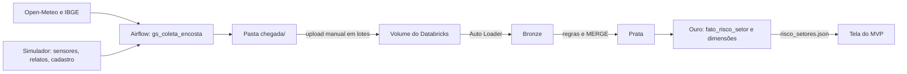

# Encosta Viva: componente de Dados

Pipeline da disciplina **Big Data Architecture & Data Integration** (Global Solution 2026.2, CitizenTech, 4ES).

## Integrantes

| Nome completo | RM |
|---|---|
| Ricardo Mattos | 95906 |
| João Gabriel Dias | 99092 |
| Julio Zampieri | 98772 |

## Ficha Técnica do MVP

| Campo | Conteúdo |
|---|---|
| **Produto** | Encosta Viva |
| **Cidadão e território** | Moradores de setores de risco alto e muito alto em encostas urbanas, e agentes da Defesa Civil |
| **Problema** | Quem mora em encosta recebe alertas genéricos por município, tarde demais e sem saber o que fazer |
| **Proposta de valor** | Nível de risco por setor, explicado pelos fatores que pesaram |
| **Componente desta entrega** | Airflow, Databricks (Bronze, Prata e Ouro) e tela do MVP |
| **Fontes de dados** | Open-Meteo e IBGE (reais), sensores, relatos e cadastro (simulados) |
| **Modelos de IA** | Não usados neste componente: o nível vem de regras explicáveis |
| **URL do MVP** | https://joaogdiass.github.io/encosta-viva-dados/ |
| **URL só com a camada Ouro** | https://joaogdiass.github.io/encosta-viva-dados/?fonte=ouro |
| **Repositório** | https://github.com/Joaogdiass/encosta-viva-dados |
| **Indicadores de impacto** | Antecedência do alerta, população em setores alertados, sensores offline |
| **ODS** | 11 (meta 11.5), 13 (meta 13.1), 9, 10 e 3 |

## Arquitetura



O Databricks Free Edition não se conecta ao Airflow, por isso o envio ao Volume é manual.

## Estrutura

```
dags/        DAG do Airflow, coletores, setores e simulador
databricks/  notebooks (00 a 03), funcoes.py e 04_consultas.sql
amostras/    um pouco de cada fonte
mvp/         tela do cidadão e o arquivo que ela consome
docs/        dados simulados e modelo do relatório
tests/       teste local sem Airflow e sem Databricks
```

## Como reproduzir

### 1. Coleta no Airflow

Requer Docker Desktop aberto.

```bash
cp .env.example .env
```

Troque a senha no `.env` e suba o Airflow:

```bash
docker compose up -d
```

Abra http://localhost:8080 (ou a porta definida em `AIRFLOW_PORTA`) e ative o DAG `gs_coleta_encosta`. A primeira ativação recupera os dias desde 25/10/2026, e os arquivos aparecem em `chegada/<fonte>/`.

**Notificação (opcional):** crie as Variables `TELEGRAM_BOT_TOKEN` e `TELEGRAM_CHAT_ID` em Admin > Variables. Sem elas, a notificação vai para o log da tarefa.

### 2. Databricks

1. Importe a pasta `databricks/` para o Workspace, mantendo os arquivos juntos.
2. Rode `00_preparar`.
3. **Lote 1:** envie os arquivos existentes para `/Volumes/workspace/gs/chegada/<fonte>/`, respeitando a pasta de cada fonte.
4. Rode `01_bronze` com `etapa=lote1`, `02_prata` com o mesmo valor e um `salt` só seu, e depois `03_ouro`. Use sempre o mesmo salt: outro valor gera outro hash e duplica os moradores.
5. **Lote 2:** em outro dia, envie só os arquivos novos e rode os mesmos notebooks com `etapa=lote2`.
6. **Reexecução:** rode `01_bronze` de novo com `etapa=reexecucao`. As contagens não podem mudar.
7. Rode as consultas de `04_consultas.sql`.

### 3. Tela do MVP

Baixe `/Volumes/workspace/gs/chegada/_mvp/risco_setores.json`, substitua `mvp/dados/risco_setores.json` e abra a tela:

```bash
py -m http.server 8765 --directory mvp
```

A tela também lê `mvp/dados/alertas.json`, gravado pelo robô de alertas (componente de Automação). Sem esse arquivo, ela funciona só com a camada Ouro.

A tela fica em http://localhost:8765. A versão pública está no GitHub Pages, na branch `gh-pages`. Para atualizá-la, faça commit na `main` e publique a pasta `mvp/`:

```bash
git subtree push --prefix mvp origin gh-pages
```

### Teste local (opcional)

Requer Java 17 e PySpark. Ele roda Prata, Ouro e as consultas com os arquivos que o Airflow gravou em `chegada/`, mas não cobre Auto Loader nem MERGE. Sem a opção abaixo, ele coleta os dados de novo pela internet.

```bash
py tests/testar_local.py --usar-chegada
```

## LGPD

- Nome e telefone, todos fictícios neste projeto, só existem na Bronze.
- Prata e Ouro guardam apenas `morador_hash` (SHA-256 com salt), setor e canal preferido.
- O salt é informado no widget do notebook e não fica no repositório.
- A tela do MVP só recebe dados agregados por setor.

## IA responsável

O nível de risco é uma sugestão explicada pela coluna `fatores`. Quem decide remover pessoas é a Defesa Civil.

## Limitações

Veja [docs/dados_simulados.md](docs/dados_simulados.md). Limiares, grau de risco e população por setor são ilustrativos.
